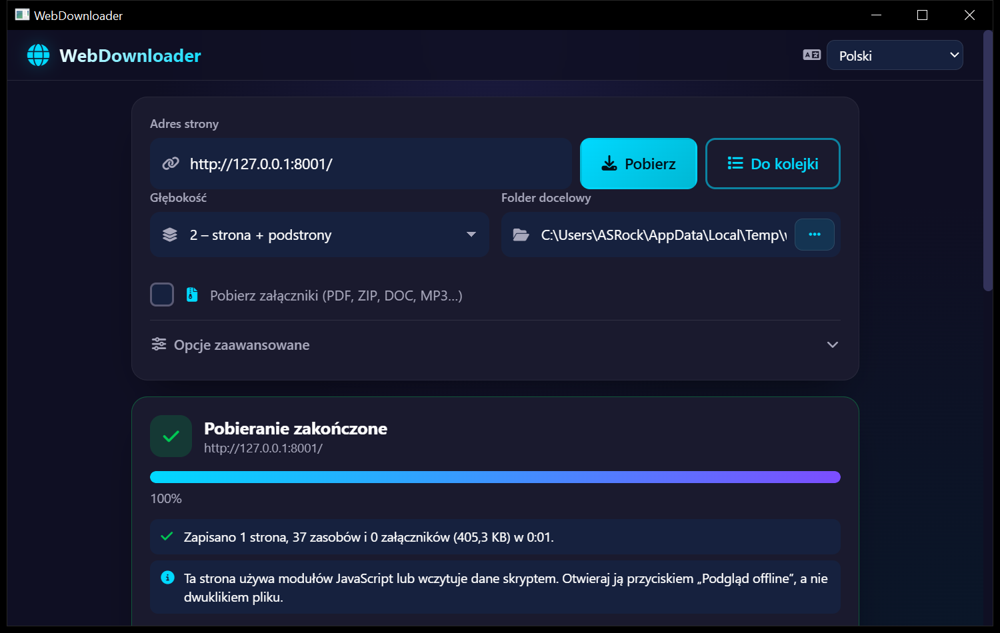

# WebDownloader

Desktop application for downloading websites with subpages, resources, and
attachments — written in **Go** with a **webview** UI.

The HTML, CSS, JavaScript, icons, and translations are embedded in the binary;
the application logic (HTTP fetching, HTML rewriting, BFS crawl) runs natively
in Go. No Node.js or Electron is required.



## Features

- Recursive page download with configurable depth (1 = start page only,
  2 = start page + pages it links to, … up to 5)
- Two modes: **Fast** (plain HTTP; reads JS modules, import maps and paths in
  JS/JSON files) and **Accurate** (renders every page in a hidden browser and
  saves everything it loads) — see [docs/engines.md](docs/engines.md)
- Accurate mode uses the **WebView2 runtime the app already needs**; Edge or
  Chrome are only fallbacks
- **Offline preview**: serves a downloaded site on `127.0.0.1` so ES modules
  and `fetch()` work (browsers block them on `file://`)
- Optional attachment download (PDF, ZIP, DOC, MP3, … — off by default)
- Clear results: a failure is shown as a failure with a plain-language reason
  and *Try again*; warnings for failed files and skipped CDN hosts
- Live progress: percentage, speed, elapsed time, ETA, queue, current file
- Downloading a site again updates the existing copy (or creates `_v2`, by
  choice)
- Delete from history moves the folder to the Recycle Bin (size shown first)
- Resume from history: continues in the same folder and skips files that
  are already complete
- Keyboard and screen-reader friendly controls; 30+ UI languages
- Fully embedded frontend with no runtime CDN dependencies
- Single-file portable executable (`--portable` keeps everything, including
  the WebView2 profile, next to the EXE)

## Requirements

- **Go 1.26.2+**
- **CGO** + a C compiler (GCC / MinGW on Windows — comes with `tdm-gcc`
  or installed via MSYS2 / Chocolatey)
- **Microsoft Edge WebView2** runtime (pre-installed on Windows 10/11 since
  2022; if missing download the Evergreen installer from
  <https://developer.microsoft.com/microsoft-edge/webview2/>)

## Quick start

```bat
git clone https://github.com/snakex21/webdownloader.git
cd webdownloader
build.bat
```

`build.bat` downloads the Go modules on first use and produces
`webdownloader.exe` in the project directory. It contains the application
icon, HTML, and translations, so it can be copied and run as a standalone
file. Pass a version to stamp it into the binary (shown in the log):
`build.bat 2.1.0`.

The release build uses `-trimpath -ldflags="-H windowsgui -s -w"`:

| Build                                   | Size (amd64) |
| --------------------------------------- | ------------ |
| `go build ./cmd/webdownloader`          | ~22.1 MB     |
| `build.bat` (`-trimpath`, `-s -w`)      | ~10.9 MB     |

`-trimpath` also keeps local source paths (and so the Windows user name)
out of the binary.

By default, preferences and logs are stored in
`%LOCALAPPDATA%\WebDownloader`, while downloaded sites go to
`%USERPROFILE%\Downloads\WebDownloader`. Run the application with
`--portable` to keep preferences, logs, and the default output directory next
to the executable.

For development checks (the same ones CI runs):

```bat
gofmt -l cmd internal tools
go vet ./...
go test -race ./...
```

`-race` needs CGO and a C compiler, which the build already requires.
`go run ./tools/examples/mythos -url https://example.com/ -depth 1 -out %TEMP%\wd-smoke`
runs the download engine from the command line without the UI (exit code
2 when nothing could be saved, e.g. a 404 start page).

## Download behaviour

- **Output layout.** Pages are saved as `path/index.html`; assets keep their
  server path. Query strings are dropped from static file names
  (`logo.png?v=3` → `logo.png`; references keep `?v=3`, so an ES module keeps
  one identity) and kept for dynamic or extension-less URLs
  (`img.php?id=1` → `img__id_1.php`), capped at 64 characters plus a hash.
- **Fast mode and scripts.** Import maps are parsed (targets downloaded,
  values rewritten); scripts are scanned for `import … from`, `export … from`,
  `import()` and `new URL('…', import.meta.url)` (resolved against the script)
  and for `fetch('…')`, `new Worker('…')` and path-like string literals such
  as `"wojna_er/index.html"` or `'data/games.json'` (resolved against the
  page; `.html` ones are crawled as pages). JSON files are scanned for
  path-like strings too. Paths built at run time (`'themes/' + name + '.css'`,
  template literals with `${…}`) cannot be found this way — use the accurate
  mode. Guessed URLs that do not exist, or that answer with an HTML error page, are skipped silently (max. 150 per page, 1500 per run); a file that failed once is not requested again in the same run.
- **Accurate mode.** Every page is opened in a hidden browser; all responses
  (modules, JSON, lazy images, fonts) are saved, links created by scripts are
  followed, and the original HTML is saved (not the script-modified DOM,
  which would render twice offline). Partial (206) media bodies are skipped.
- **Opening offline.** Sites that use ES modules or `fetch()` only work over
  HTTP: use *Offline preview* (a server on `127.0.0.1` with a random port,
  only for folders in history). The result says when a site needs it.
- **External hosts.** CDN files are skipped unless *Download resources from
  CDNs* is on; the result lists how many references were skipped and where.
- **Existing copies.** Downloading a site again updates the existing folder
  (every file is fetched again) unless *Create a new copy* is chosen.
  File names come from the URL, not from `Content-Disposition`, so links in
  the mirror can be rewritten before a file is fetched.
- **Path safety.** URL paths containing `..`, Windows-reserved names
  (`CON`, `NUL`, `COM1`, …), characters Windows rejects, or trailing dots and
  spaces are refused; all writes go through `os.Root`, so nothing can be
  written outside the output folder (also via symlinks).
- **No partial files.** Every file is streamed to a `*.wdpart` temp file and
  renamed into place only when complete; on cancel, network errors, disk
  full or access denied the temp file is removed. Large files are streamed
  to disk, not buffered in memory (HTML and CSS are read into memory because
  they are rewritten).
- **Resume.** There is no HTTP `Range` resume of a single file; instead a
  resumed run reuses every file that is already complete and downloads the
  rest.
- **Timeouts and retries.** A request fails when no data arrives for 30 s
  (slow but steady downloads are not cut off). Network errors, timeouts,
  HTTP 408, 429 and 5xx are retried twice with exponential back-off
  (0.5 s, 1 s), honouring `Retry-After` up to 10 s. Up to 10 redirects are
  followed; a pasted cookie is only sent to the starting origin.
- **Errors.** If the start page cannot be saved the run is reported as
  failed with a classified reason (HTTP status, DNS, refused, timeout, TLS,
  missing browser) and no empty folder is left behind. Other failed files
  are listed in the UI log, `download-errors.log` and `download-report.json`.
- **Concurrency.** Pages are crawled one at a time, with a 0.25 s pause
  between pages to be polite to the server.

## Layout

```
.
├── cmd/
│   └── webdownloader/
│       ├── main.go          # application startup
│       ├── api.go           # frontend RPC state
│       ├── bridge.go        # webview bindings and events
│       ├── download.go      # download commands and lifecycle
│       ├── preferences.go   # persistent user preferences
│       ├── system.go        # operating-system commands
│       ├── pickdir_*.go     # native folder picker
│       ├── window_*.go      # window state per platform
│       ├── rsrc_*.syso      # compiled Windows resources
│       └── resources/
│           └── icon.png     # source application icon
├── internal/
│   ├── downloader/
│   │   ├── fetcher.go       # HTTP client (redirects, UA, timeout)
│   │   ├── browser.go       # accurate mode: CDP network capture
│   │   ├── jsrefs.go        # JS / JSON / import map reference scanner
│   │   ├── html.go          # goquery-based HTML parsing & rewriting
│   │   ├── css.go           # url() / @import rewriting
│   │   ├── path.go          # URL → on-disk path mapping and validation
│   │   ├── storage.go       # atomic, root-confined file writes
│   │   ├── errors.go        # failure classification for the UI
│   │   └── downloader.go    # BFS orchestrator + event callbacks
│   ├── wv2host/             # hidden private WebView2 with a DevTools port
│   ├── preview/             # offline preview server (127.0.0.1)
│   ├── locale/
│   │   └── locale.go        # system UI language detection
│   └── webui/
│       ├── assets.go        # embedded frontend access
│       └── web/
│           ├── index.html   # frontend structure
│           ├── styles.css   # frontend styles
│           ├── app.js       # frontend behavior
│           ├── i18n.json    # 30+ language translations
│           └── vendor/      # offline third-party assets and licenses
├── docs/
│   └── images/              # README and documentation images
├── tools/
│   ├── examples/            # standalone usage examples
│   ├── enginebench/         # measures a run (time, browser memory, files)
│   └── i18n/                # translation maintenance scripts
├── third_party/webview_go/  # webview_go + one-line profile-folder patch
├── build.bat                # builds webdownloader.exe
└── go.mod
```

## CLI flags

```
webdownloader.exe [--debug] [--portable]
```

- `--debug` — enable the webview DevTools (right-click → Inspect). Useful
  for tweaking the front-end; not needed by end users.
- `--portable` — store preferences, logs, downloads and the WebView2
  browser profile (`webview2-profile\`) next to the EXE.

`WEBDOWNLOADER_BROWSER` (environment) points the Edge/Chrome fallback of the
accurate mode at a specific browser executable.

## How it works

1. The frontend is embedded by `internal/webui` and served from memory on a
   random loopback address (`127.0.0.1`). No temporary UI files are created;
   preferences and history are persisted by the Go backend.
2. The Go side exposes a small RPC API to JS (`api_download`,
   `api_cancel`, `api_pause`, `api_resume`, `api_pickFolder`,
   `api_openFolder`, `api_openFile`, `api_revealPath`, `api_getLocale`,
   `api_defaultOutputPath`, `api_savePrefs`, `api_loadPrefs`,
   `api_deleteFolder`, `api_deleteHistoryItem`, `api_folderInfo`,
   `api_startPreview`, `api_engines`, `api_i18n`). Paths passed to the
   open/delete/preview calls are validated in Go (only directories / `.html`,
   `.json`, `.log` files; only recorded download folders can be deleted or
   previewed; a running download cannot be deleted).
3. `api_download` spawns a goroutine that runs the BFS crawl, emitting
   `progress`, `asset`, `error` and `complete` events back to the UI
   via `webview.Dispatch + Eval`.
4. The HTML rewriter uses `goquery` (a `cheerio`-style library) to find
   every relative asset reference (``, `<link>`, `<script>`,
   `<source>`, `<video>`), download it, and rewrite the `src`/`href`/
   `poster` attribute to a relative on-disk path. Inter-page `<a href>`
   links are rewritten similarly so the saved site is fully browseable
   offline.

## License

MIT.
